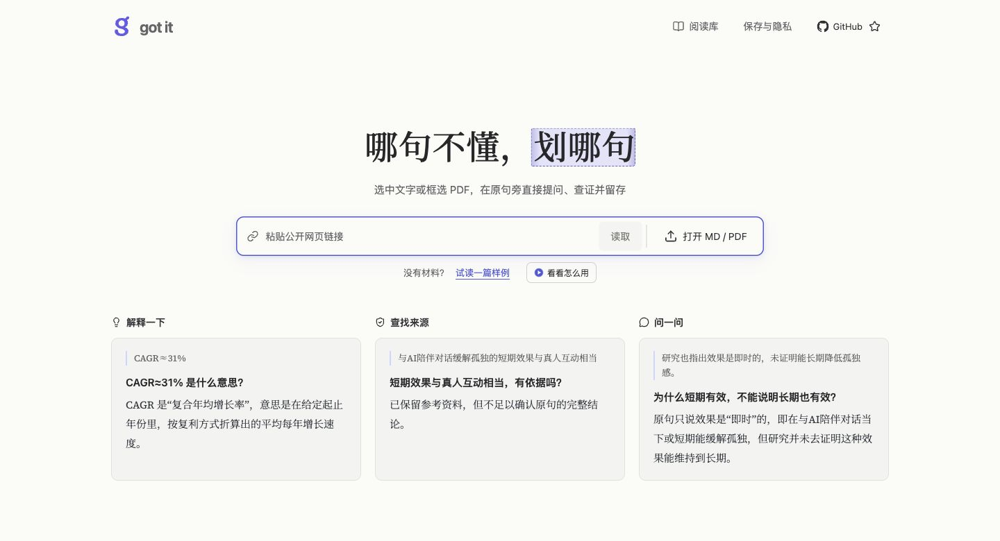
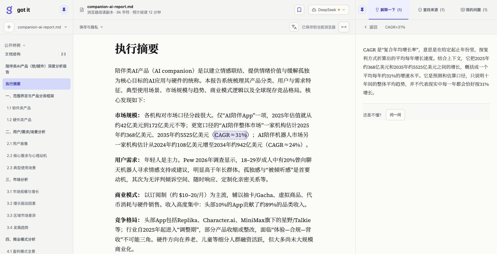

# got it

[简体中文](README.md) · **English**

## If a line doesn't make sense, select it

Select text or box a PDF region to ask, check sources, and keep what you learn beside the passage

**[Try it online →](https://gotit.bingbryan.com/)**

Open the website and start reading. No installation needed.

An unfamiliar concept, a difficult argument, or a figure worth checking shouldn't mean leaving the article and switching tools. Bring Markdown files, PDFs, and public web articles into one reading library. Work through the question in front of you, then carry on reading.

### Choose the help you need for the passage

- **Explain:** make sense of an unfamiliar concept or difficult paragraph in clear language, with its context.
- **Find sources:** look for the origin of a figure or claim and see whether the material supports the passage. When there isn't enough evidence, that result stays visible too.
- **Ask:** pose a specific question about your selection—compare two ideas, explore a reason, or work through a step in an argument.

Answers stay as knowledge cards beside the original passage. Return to an explanation, question, or source without hunting for its context. Reopen the material and continue from where you left off.

### Start in three steps

1. Open a Markdown or PDF file, or paste a public article link.
2. Select the text you want to understand, or box an image or chart in a PDF.
3. Choose Explain or Find sources, or write your own question.

Bookmark passages you want to keep, and switch foreign-language material to a full Chinese translation for easier reading and review.

Materials, knowledge cards, and reading progress stay in your current browser. Original files remain unchanged.
